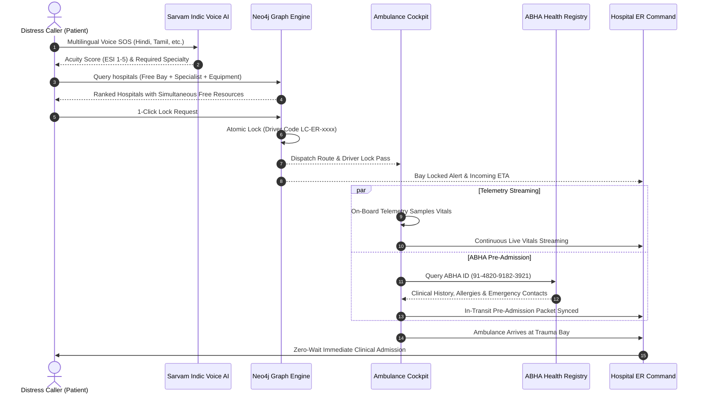

# LifeCare — AI Emergency Triage & Zero-Wait Hospital Orchestration Platform

[](https://whereuelevate.com)
[](https://react.dev)
[](https://www.typescriptlang.org)
[](https://tailwindcss.com)
[](https://vitejs.dev)
[](https://oxc.rs)

> **LifeCare** is a synchronized emergency healthcare operating system connecting **Distress Callers**, **Ambulance Cockpits**, and **Hospital Emergency Departments** in real time. By uniting **Sarvam Indic Voice AI**, a **Neo4j Cypher Knowledge Graph Engine**, and an **ABDM-Compliant Zero-Wait Emergency Highway** (complemented by an **Arduino UnoQ & Autonomous Sensor Hardware Roadmap**), LifeCare replaces chaotic, fragmented hospital intake with guaranteed **Zero-Wait Golden Hour Admissions**.

### 👥 Team Members
- **Susheem Kumar Maurya**
- **Stuti Jain**
- **Saksham Kaushik**

*Developed for HackFront India 2026 by whereuelevate.com*

---

## 📑 Table of Contents
1. [HackFront Multi-Track Alignment Matrix](#-hackfront-multi-track-alignment-matrix)
2. [The Critical Problem: India's Golden Hour Crisis](#-the-critical-problem-indias-golden-hour-crisis)
3. [The LifeCare Solution: 4 Synchronized Pillars](#-the-lifecare-solution-4-synchronized-pillars)
4. [Hardware Roadmap: Next-Gen Autonomous ER Infrastructure](#-hardware-roadmap-next-gen-autonomous-er-infrastructure)
5. [Interactive Demo Walkthrough (Judge's Guide)](#-interactive-demo-walkthrough-judges-guide)
6. [System Architecture & Data Flow](#-system-architecture--data-flow)
7. [Repository Organization & File Structure](#-repository-organization--file-structure)
8. [Visual Identity: Apple OS Liquid Glass](#-visual-identity-apple-os-liquid-glass)
9. [Local Setup & Verification](#-local-setup--verification)

---

## 🏆 HackFront Multi-Track Alignment Matrix

LifeCare is architected to reflect the exact state of the prototype: **3 Active Tracks** implemented end-to-end, complemented by **3 Future Hardware Tracks** with working simulation models and engineering specifications:

### 1. Active Tracks Used (Live in Prototype)

| Track | Problem Solved | LifeCare Implementation | Code Location | Status |
|---|---|---|---|---|
| **Neo4j Track**<br>*(Knowledge Graph)* | Finding hospitals with simultaneously available Bed + on-duty Specialist + operational Equipment. | Graph schema: `(:Hospital)-[:HAS_BAY]->(:ERBay)-[:RESERVES_DOCTOR]->(:Doctor)`. Cypher query generation for zero-conflict atomic resource locks (`LC-ER-xxxx`). | `src/components/patient/Neo4jGraphExplorer.tsx`<br>`src/data/mockData.ts` | **Active Track** |
| **Sarvam Track**<br>*(Indic Voice AI)* | Distress callers in panic cannot articulate complex medical symptoms in English or type long text. | Native voice SOS speech-to-text in 7 Indian languages (Hindi, Tamil, Telugu, Bengali, Marathi, Kannada, English) with clinical Acuity scoring (ESI 1-5). | `src/components/patient/EmergencySearch.tsx`<br>`src/services/aiTriageService.ts` | **Active Track** |
| **General Track**<br>*(Zero-Wait ER)* | Fragmented emergency workflows across dispatchers, ambulances, and hospital ER desks. | Complete end-to-end production application: Google Maps turn-by-turn routing, ABDM In-Transit ABHA Pre-Admission, Web Audio API sound synthesis. | `src/App.tsx`<br>`src/components/hospital/HospitalPortal.tsx`<br>`src/context/EmergencyContext.tsx` | **Active Track** |

### 2. Future Tracks to be Added (Hardware IoT Roadmap)

| Hardware System | Target Board & Sensors | Architectural Purpose | Working Component | Status |
|---|---|---|---|---|
| **1. Arduino UnoQ Ambulance IoT** | Arduino UnoQ Rev 2.0, MAX30102 (SpO2/HR), NIBP Transducer, UART @ 115200 bps | Real-time biosensor acquisition streaming patient vitals to the receiving hospital ER bay during transit. | `src/components/ambulance/ArduinoUnoQMonitor.tsx` | **Future Track Simulator** |
| **2. Piezoelectric Auto-Bed Sensor** | PVDF Piezoelectric Film Matrix under ER mattresses | Continuous weight & presence sensing (>15 kg = Occupied / <5 kg = Free), updating Neo4j graph in <250ms without nurse data entry. | `src/components/tracks/FooterTracksSection.tsx`<br>`src/components/hospital/HospitalPortal.tsx` | **Future Hardware Track** |
| **3. Biometric Doctor Tracking** | Optical Fingerprint + BLE Proximity Turnstiles at OT/ER scrub | Physical on-duty verification ensuring patients are only dispatched to hospitals with verified on-site specialists. | `src/components/tracks/FooterTracksSection.tsx`<br>`src/components/hospital/HospitalPortal.tsx` | **Future Hardware Track** |

---

## 🚨 The Critical Problem: India's Golden Hour Crisis

In medical trauma, acute myocardial infarction (heart attack), and ischemic stroke, **the first 60 minutes ("The Golden Hour") decide survival**. Every minute delayed decreases survival chances by **7% to 10%**.

Today's emergency response ecosystem suffers from **four critical failures**:

```
[Distress Caller] ──(Blind Choice)──► [Nearest Hospital] ──(Full Bay Rejection)──► [Secondary Hospital]
        │                                                                                     │
   Panic barrier                                                                        Fatal delay
  Language issues                                                                      (20-45 mins)
```

1. **Blind Ambulance Transits:** Dispatchers and drivers navigate to the nearest facility without knowing if an ICU bed or cath lab is open.
2. **Fatal ER Diverts & Rejections:** Over 35% of emergency transfers arrive at emergency departments only to find the trauma bay full or the specialist surgeon off-site.
3. **In-Transit Data Void:** Paramedics lack a telemetry link to the hospital; receiving trauma teams only begin prepping *after* the patient is wheeled in.
4. **Manual Reception Bottleneck:** 20 to 30 minutes are squandered at registration desks filling paper forms, paying upfront deposits, and retrieving lost medical histories.

---

## 💡 The LifeCare Solution: 4 Synchronized Pillars

LifeCare replaces this fragmented process with an **interlocked 4-pillar digital response network**:

```
                       ┌────────────────────────────────────────────────────────┐
                       │          Pillar 1: Sarvam Indic Voice AI SOS           │
                       │    (Hindi, Tamil, Telugu, Bengali, Marathi, Kannada)   │
                       └───────────────────────────┬────────────────────────────┘
                                                   │
                                                   ▼
                       ┌────────────────────────────────────────────────────────┐
                       │         Pillar 2: Neo4j Knowledge Graph Engine         │
                       │    (Simultaneous Bed + Specialist + Machinery Lock)    │
                       └─────────────────────┬───────────────────┬──────────────┘
                                             │                   │
                                             ▼                   ▼
    ┌───────────────────────────────────────────────┐  ┌───────────────────────────────────────────────┐
    │     Pillar 3: In-Transit ABHA Pre-Admission   │  │     Pillar 4: Smart ER & Ambulance IoT        │
    │ - ABDM Health ID Lookup & Verification        │  │ - Arduino UnoQ Telemetry Simulator (Future)   │
    │ - Prior Allergies & Chronic History Pre-Sync │  │ - Piezoelectric Bed Sensors Roadmap (Future)  │
    │ - 0-Second ER Reception: Direct Bay Wheel-In  │  │ - Biometric Doctor Presence Tracking (Future) │
    └───────────────────────────────────────────────┘  └───────────────────────────────────────────────┘
```

### Pillar 1: Multilingual Voice SOS (Sarvam Indic AI)
- Built for panic scenarios where typing or speaking English is impossible.
- Supports **7 Indian Languages**:
  - **Hindi (हिन्दी):** *"सीने में बहुत तेज दर्द है और सांस लेने में तकलीफ हो रही है"*
  - **Tamil (தமிழ்):** *"நெஞ்சு வலி அதிகமாக உள்ளது, இடது கை மரத்துப்போனது"*
  - **Telugu (తెలుగు):** *"తీవ్రమైన రోడ్డు ప్రమాదం, తలకు గాయమై స్పృह కోల్పోయారు"*
  - **Bengali (বাংলা):** *"বুকে প্রচণ্ড ব্যথা ও শ্বাসকষ্ট হচ্ছে, বাঁ হাত অবশ"*
  - **Marathi (मराठी):** *"अचानक तोल गेला, बोलताना अडखळत आहे आणि डावी बाजू काम करत नाही"*
  - **Kannada (ಕನ್ನಡ):** *"ಎದೆ ನೋವು ತೀವ್ರವಾಗಿದೆ ಮತ್ತು ಉಸಿರಾಟದ ತೊಂದರೆ ಇದೆ"*
  - **English:** Voice & text clinical intake with instant phonetic recognition.
- Automatically computes **Acuity Level (ESI 1-5)** and matches medical specialty in sub-400ms.

### Pillar 2: Dynamic Knowledge Graph Matching (Neo4j Cypher Engine)
- Instead of naive distance lookup, Neo4j queries the graph for simultaneous constraints:
  - Is an **ER / ICU Bay** free?
  - Is the required **Specialist Doctor** physically on duty?
  - Is the necessary **Machinery** (Cath Lab, 128-Slice CT, Ventilator) operational?
- Generates a **unique Driver Lock Code** (`LC-ER-xxxx`) and executes an atomic reservation, eliminating race conditions.

### Pillar 3: In-Transit ABHA Digital Pre-Admission (ABDM Compliant)
- Pre-loads patient health ID (ABHA `91-4820-9182-3921`) during the ambulance journey.
- Automatically syncs blood group, chronic conditions, and critical allergies to the hospital ER.
- Patient bypasses registration desks completely on arrival: **True Zero-Wait ER Admission**.

### Pillar 4: Smart Ambulance & Hospital IoT (Hardware Roadmap)
- Features a working simulator of the planned **Arduino UnoQ Rev 2.0** edge unit sampling MAX30102 SpO2/HR and NIBP transducers.
- Outlines embedded **Piezoelectric Bed Occupancy Sensors** and **Biometric RFID/Fingerprint Turnstiles** for autonomous ground-truth telemetry.

---

## 🔬 Hardware Roadmap: Next-Gen Autonomous ER Infrastructure

To further eliminate human latency, LifeCare outlines two production-ready hardware upgrades:

### 1. Piezoelectric Automatic Bed Availability Sensors
- **Physical Construction:** High-sensitivity piezoelectric film matrix placed beneath ER mattress toppers.
- **Autonomous Presence Sensing:** Detects patient placement, weight shifts, and vacation without nurses manually updating logs.
- **Instant Graph Update:** Bed status automatically flips between `FREE` and `OCCUPIED` in Neo4j within **250ms**.
- **Fall Detection:** Triggers immediate audio-visual alerts if an unstable patient slips or falls out of bed.

### 2. Biometric RFID & Fingerprint Doctor Duty Tracking
- **Physical Verification:** Wall-mounted biometric scanners installed at emergency trauma bay entrances.
- **Eliminates Paper Roster Lag:** Guarantees that only doctors who physically authenticate inside the ER wing are marked as `onDuty: true` in Neo4j.
- **Automated Paging:** Immediately pages the checked-in specialist when an incoming critical transit locks their bay.

---

## 🕹️ Interactive Demo Walkthrough (Judge's Guide)

Follow this 5-minute interactive test script to verify all prototype features:

### Step 1: Distress Caller SOS Intake (Citizen View)
1. Launch the interactive prototype and open the application in your browser.
2. Click **"Sarvam Indic Voice AI (7 Languages)"** in the top SOS intake bar.
3. Select any Indian language (e.g. **Hindi**, **Tamil**, or **Telugu**).
4. Click one of the test prompts (e.g. *"सीने में बहुत तेज दर्द है और सांस लेने में तकलीफ हो रही है"*).
5. Notice:
   - AI immediately computes **Acuity Level 1 (Critical)** in red.
   - Required specialty identifies **Interventional Cardiology**.
   - Required machinery flags **Cath Lab & Ventilator**.

### Step 2: Zero-Wait Hospital ER Locking
1. Click **"Find Ready ER & Doctors"** — the UI automatically fast-scrolls to the ranked hospital list.
2. Observe hospital cards displaying live distance, travel time, available ICU/Trauma bays, on-duty specialist doctors, and operational equipment.
3. Click **"Book Bed & Dispatch Ambulance"** on the top recommendation (e.g. *Apex Heart & Trauma Super-Specialty*).
4. Audio chime plays; a confetti explosion confirms the reservation.
5. The **Driver Lock Pass** is issued with unique code (e.g. `LC-ER-7429`) and reserved bay (`Trauma Bay 01`).

### Step 3: Ambulance Cockpit & Telemetry
1. Click **"Ambulance Cockpit"** in the top navigation or bottom emergency dock.
2. Paramedic view loads with Google Maps turn-by-turn route, live ETA, and patient vitals.
3. Open the **"Arduino UnoQ Hardware Monitor"** module to inspect live simulated telemetry packets and on-board Arduino C++ sketch code.
4. Adjust patient vitals sliders (SpO2, Heart Rate, BP, GCS scale) and click **"Transmit Live Vitals"**.
5. Inspect the **In-Transit ABHA Paperwork** tab: Enter ABHA ID `91-4820-9182-3921` to verify pre-loaded chronic history and allergies.

### Step 4: Hospital ER Command Center
1. Click **"Login as Hospital"** in the top navigation.
2. Select the booked hospital (e.g. *Apex Heart & Trauma Super-Specialty*).
3. Notice:
   - An audio emergency klaxon sounds for incoming ambulance transit.
   - The reserved bay (`Trauma Bay 01`) displays **LOCKED** status with the matching driver code.
   - Paramedic-transmitted vitals and ABHA pre-admission records appear directly on the ER triage console.
   - Doctor and bay management controls allow live toggling of hospital status.

### Step 5: Neo4j Cypher Knowledge Graph Explorer
1. Return to Citizen view and toggle the **"Neo4j Knowledge Graph & Cypher Engine"** panel.
2. Explore graph nodes (`Hospitals`, `ER Bays`, `Doctors`, `Machinery`).
3. Click pre-built Cypher queries and hit **"Execute Cypher Query"** to see live graph path traversal and constraint resolution.

---

## 🏛️ System Architecture & Data Flow



---

## 📁 Repository Organization & File Structure

```
LifeCare/
├── public/                               # Favicon and static assets
│   └── favicon.svg                       # LifeCare heartbeat pulse icon
├── src/
│   ├── components/
│   │   ├── ambulance/                    # Ambulance cockpit & hardware telemetry
│   │   │   ├── AmbulancePortal.tsx       # Live transit, vitals transmitter & ABHA sync
│   │   │   └── ArduinoUnoQMonitor.tsx    # Arduino UnoQ hardware telemetry UI
│   │   ├── hospital/                     # Hospital ER triage command
│   │   │   └── HospitalPortal.tsx        # ER command station & bay/doctor locking
│   │   ├── patient/                      # Citizen emergency intake & triage
│   │   │   ├── BookingConfirmedModal.tsx # Driver dispatch code & ABHA pass modal
│   │   │   ├── EmergencySearch.tsx       # Sarvam Indic Voice SOS & clinical triage
│   │   │   ├── HospitalMatchList.tsx     # Hospital zero-wait ranking & booking
│   │   │   └── Neo4jGraphExplorer.tsx    # Interactive Cypher graph canvas
│   │   ├── tracks/                       # HackFront hackathon multi-track showcase
│   │   │   ├── FooterTracksSection.tsx   # Persistent tracks & hardware roadmap
│   │   │   └── HackFrontTrackModal.tsx   # Track breakdown & code mapping modal
│   │   └── Navbar.tsx                    # Apple OS Liquid Glass navigation
│   ├── context/
│   │   └── EmergencyContext.tsx          # Reactive global state (Locks, Vitals, Beds)
│   ├── data/
│   │   ├── mockData.ts                   # Realistic hospitals, ER bays, doctors & ABHA
│   │   └── trackMockData.ts              # Cypher queries, graph nodes & Arduino packets
│   ├── services/
│   │   └── aiTriageService.ts            # Clinical acuity scoring & specialty matching
│   ├── utils/
│   │   ├── audio.ts                      # Web Audio API procedural sound engine
│   │   └── scrollHelper.ts               # Smooth UX fast-scroll helper
│   ├── App.tsx                           # Master layout and view switcher
│   ├── index.css                         # Apple Liquid Glass styling and animations
│   ├── main.tsx                          # React 19 entry point
│   └── types.ts                          # Strictly typed TypeScript interfaces
├── index.html                            # HTML5 entry with Plus Jakarta Sans & JetBrains Mono
├── package.json                          # Dependencies (React 19, Tailwind CSS 4, Lucide)
├── tsconfig.json                         # TypeScript strict configuration
└── vite.config.ts                        # Vite 8 build pipeline
```

---

## 🎨 Visual Identity: Apple OS Liquid Glass

LifeCare is styled with an **Apple OS Liquid Glass (White & Red Healthcare)** aesthetic:

- **Liquid Glass Cards:** Multi-surface frosted glass cards (`backdrop-filter: blur(28px) saturate(190%)`) with hairline translucent borders (`rgba(255, 255, 255, 0.85)`) and specular top-edge light highlights (`box-shadow: inset 0 1px 1.5px 0 rgba(255, 255, 255, 0.95)`).
- **Liquid Red Glossy Buttons:** Tactile pill design with specular top reflection gradients (`linear-gradient(180deg, #F87171 0%, #EF4444 32%, #DC2626 100%)`) and spring-like active compression (`active:scale-[0.975]`).
- **Fluid Ambient Canvas:** Multi-layered organic ambient lighting mesh with floating fluid aura gradients (`radial-gradient` spheres of soft rose/crimson `#EF4444`, peach, and icy slate) that refract through frosted glass cards.
- **Auditory Feedback:** Procedural sound synthesis via the browser Web Audio API — synthesizes clinical heart monitor pulses, driver lock chimes, and emergency klaxon alerts with zero external audio assets.

---

## ⚡ Local Setup & Verification

### Prerequisites
- Node.js 18+ or 20+
- npm or pnpm

### 1. Install Dependencies
```bash
cd LifeCare
npm install
```

### 2. Start Development Server
```bash
npm run dev
```
Open the running local application address displayed in your terminal.

### 3. Production Build Verification
```bash
npm run build
```
Compiles TypeScript and bundles via Vite:
```
✓ 2045 modules transformed.
dist/index.html                   1.84 kB
dist/assets/index.css            88.47 kB
dist/assets/index.js            487.99 kB
✓ built in 236ms
```

### 4. Lint Verification
```bash
npm run lint
```
Output:
```
Found 0 warnings and 0 errors.
```

---

## 👥 Hackathon Attribution & Team

- **Competition:** HackFront India 2026
- **Host / Platform:** whereuelevate.com
- **Project Name:** LifeCare — AI Emergency Triage & Zero-Wait Hospital Orchestration
- **Team Members:**
  - **Susheem Kumar Maurya**
  - **Stuti Jain**
  - **Saksham Kaushik**
- **Status:** Complete, tested, fully functional prototype ready for jury evaluation.
